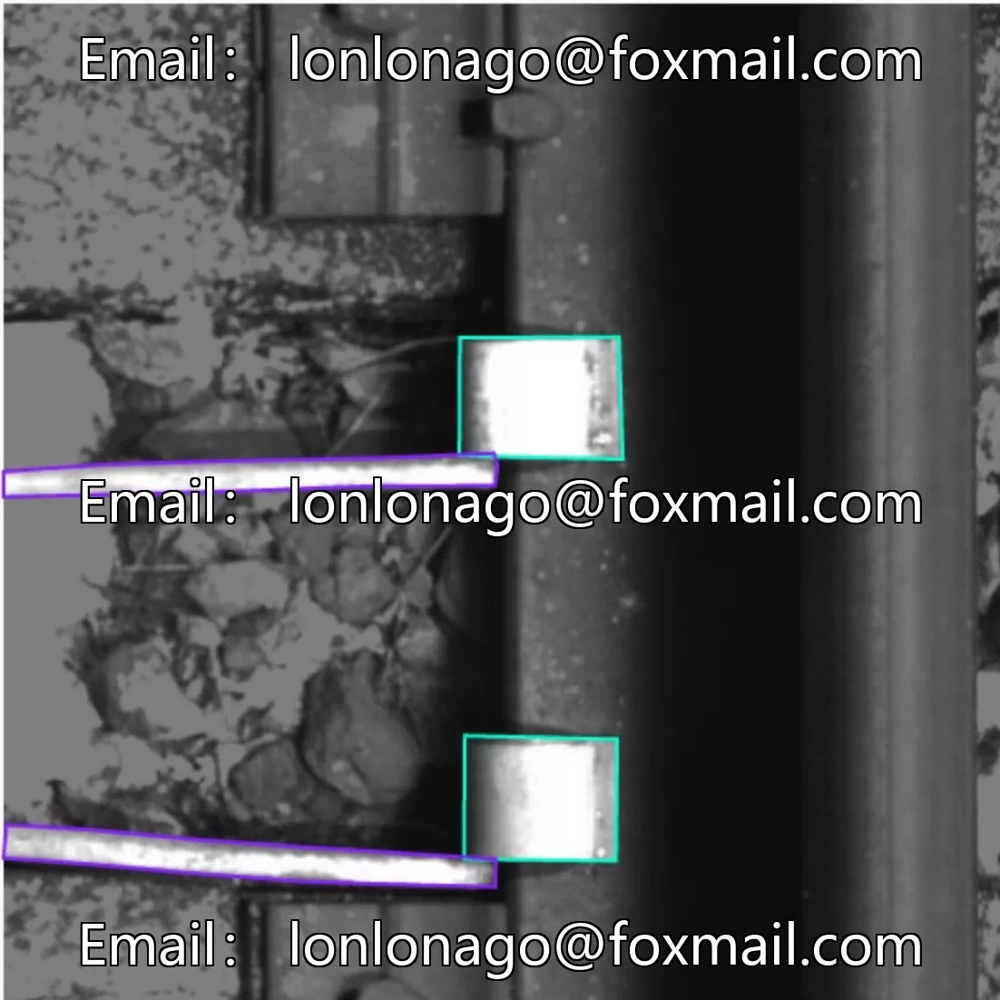
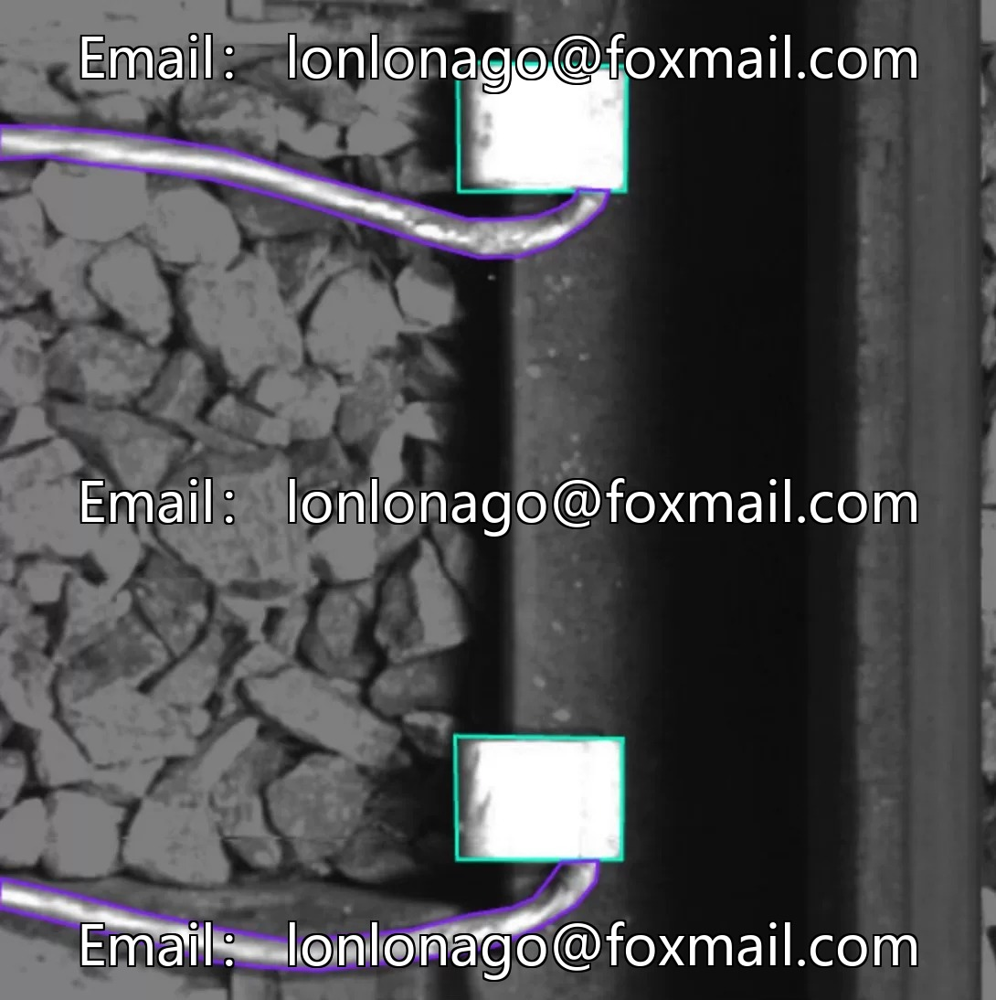
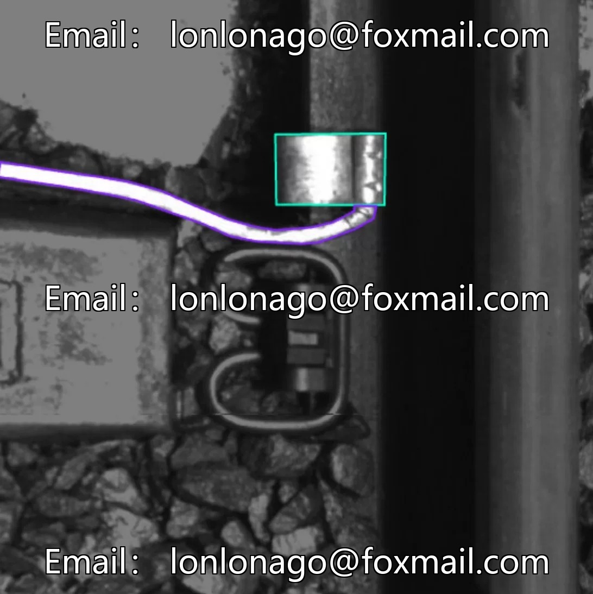
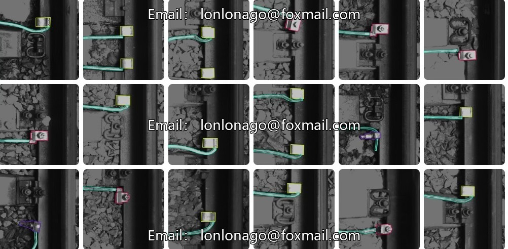
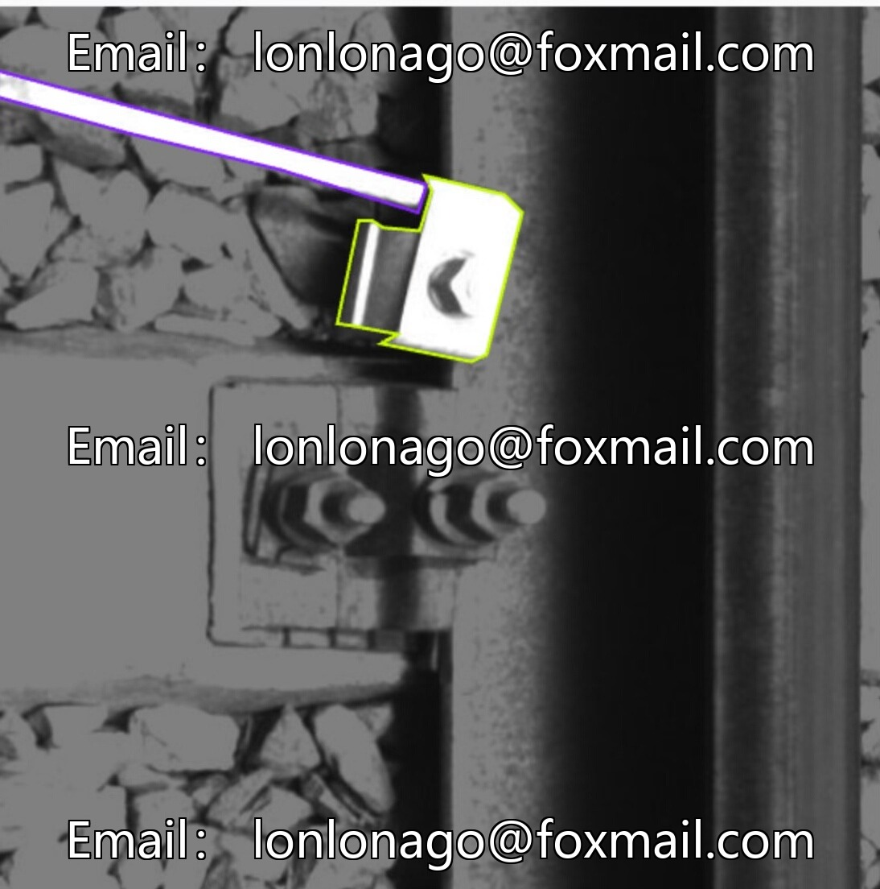
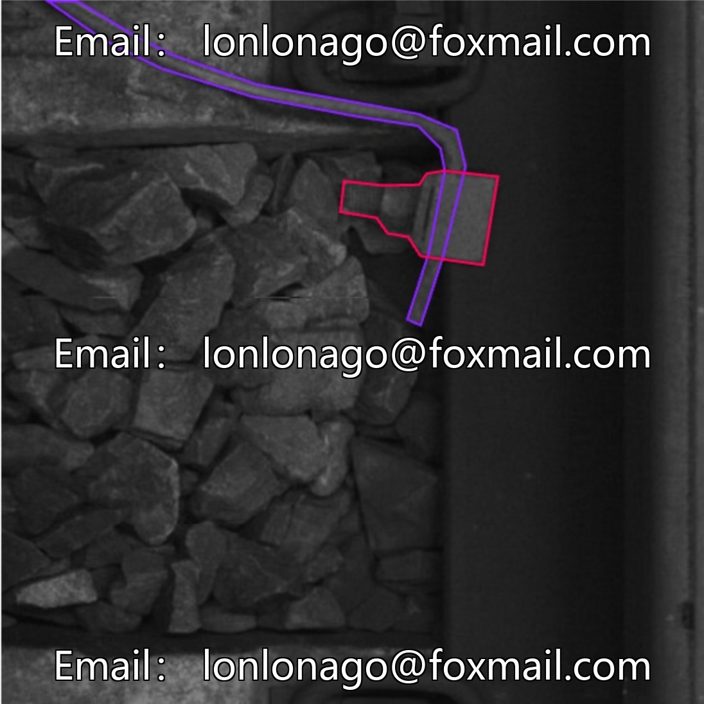

# Intelligent Railway Image Recognition Dataset, Railway Example Segmentation Data, Track Ground Box Segmentation Recognition

## Body

Intelligent Railway Image Recognition Dataset, Railway Instance Segmentation Data, Track Ground Box Segmentation and Recognition, Railway Line Image Segmentation Dataset, AI Issue No. 10239

Dataset Category: Computer Vision Field - Instance Segmentation Dataset for Railway Scenarios, focusing on visual information labeling and analysis related to railway scenes.
Number of Images: 1035 images (including enhanced versions), accompanied by 2 datasets files, with basic model training data support.
Format Description: Image files (such as JPG/PNG) + Annotation files (such as JSON/XML), compatible with the computer vision model training process.
Label System: Ground Box (ground box), Ground Side (ground side), Ground Up (on the ground), Wire (wire), totaling 4 categories.
Application Value: Railway track component recognition, line status monitoring, enhancing the intelligence of railway operation and maintenance, improving safety detection efficiency and accuracy.

Virtual materials, once sold, are non-refundable.
Interested friends, click "I want" to proceed.

## Images

## Payment

Here is a pay link on Stripe ( https://buy.stripe.com/3cs8yP7sY87d0vu9AB ). Please contact me lonlonago@foxmail.com after funding $89, and I will send you a complete data files , thank you!

